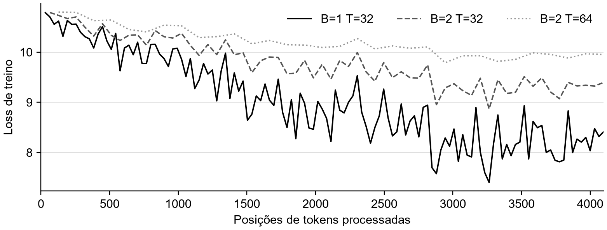

# Implementação do GPT 2

Professor: Victor Hugo Wanderley Freire

Roberto Almeida Burlamaque Catunda | 04 de novembro de 2026

## Parte 1 O que foi implementado

1. O objetivo deste trabalho foi implementar o caminho que transforma um texto em previsões para o próximo token. A implementação partiu do vídeo do Andrej Karpathy, utilizando minhas anotações junto das classes e operações. A implementação reúne atenção causal, múltiplas cabeças, embeddings, blocos de Transformer e um laço de treino e geração.

2. O modelo usado nos experimentos começou com pesos aleatórios. O tokenizer do GPT-2 foi reutilizado pelo tiktoken, mas isso não significa carregar os pesos da rede neural. Ele define como dividir o texto e quais IDs representam essas partes. Já os embeddings e as matrizes de atenção e do MLP foram ajustados durante estes treinamentos. A opção de carregar pesos pretrained existe no código, mas não foi usada nos experimentos deste relatório.

3. Para rodar na minha máquina, utilizei o perfil small: quatro blocos, quatro cabeças por bloco, embeddings de 128 dimensões e janela máxima de 128 tokens. São 7.248.640 parâmetros únicos. As peças seguem a arquitetura estudada, mas essa escala não é o GPT-2 completo de aproximadamente 124 milhões de parâmetros. O perfil maior continua disponível, sem ter sido treinado nestes experimentos.

4. O fluxo completo ficou assim: texto → IDs de tokens → embeddings de token e posição → blocos de atenção e MLP → normalização final → logits. No treino, os logits são comparados aos próximos tokens corretos para calcular a loss. Na geração, eles são usados para escolher um token, acrescentá-lo ao contexto e repetir a operação.

5. Os resultados mostraram que o treino reduziu a perda em um trecho separado de validação, mas as amostras continuaram repetitivas e sem coerência. Em minha visão, esse resultado serve para verificar o processo em pequena escala. Ele não comprova compreensão de linguagem nem uma reprodução da qualidade do GPT-2 original.

## Parte 2 Do texto ao batch

1. O corpus de treinamento contém o texto usado para aprender a prever a continuação. O tiktoken aplica o vocabulário e as regras de tokenização do GPT-2. Como discutido na apostila, a unidade não precisa ser uma palavra inteira: uma palavra pode ser um token ou vários pedaços, e espaços e pontuações também participam dessa divisão. Isso muda quantos tokens cabem no contexto.

2. O corpus produziu 338.025 tokens. Separei os primeiros 304.222 para treino e os últimos 33.803 para validação, correspondendo ao corte de 90% e 10%, com arredondamento. A separação ocorre antes de criar os loaders, evitando que os mesmos índices do arquivo sejam usados nos dois conjuntos. Como são trechos de um mesmo corpus, isso ainda não representa um teste em outro domínio.

3. O DataLoaderLite recebe B, T e os tokens do conjunto. B é o número de sequências do batch; T é a quantidade de tokens em cada sequência. Com B=2 e T=64, x e y têm shape (2, 64). O modelo calcula 128 previsões por microbatch. T é o comprimento daquele exemplo, enquanto block_size é o limite máximo permitido pelo modelo.

4. Para obter os alvos, o loader lê B×T+1 tokens. Ele usa todos menos o último como entrada e todos menos o primeiro como saída esperada. Por exemplo, se a entrada for [A, B, C, D], os alvos serão [B, C, D, E]. São IDs de tokens no código; as letras aqui só simplificam a explicação. A posição de C deve prever D, utilizando o contexto disponível até C.

5. As operações buffer[:-1].view(B, T) e buffer[1:].view(B, T) organizam as sequências. O view altera a interpretação das dimensões, sem trocar a ordem dos elementos. Depois de usar um batch, o loader avança B×T posições. Quando não há espaço para outro batch completo, volta ao início. Isso permite repetir o corpus, mas também permite decorar os exemplos se o treino continuar por muito tempo.

6. Esse deslocamento dos alvos aparece no roteiro de mini-GPT da apostila. Uma entrada e um alvo com o mesmo shape não bastam: o alvo precisa representar a próxima posição. Se os índices forem montados incorretamente, o programa pode executar e mesmo assim aprender uma tarefa diferente da pretendida.

## Parte 3 Embeddings e posição

1. O ID identifica qual token entrou, mas não é uma medida de significado. Por isso, wte é uma tabela aprendida: cada linha fornece um vetor de 128 números para um ID. Com o batch (2, 64), a consulta retorna tok_emb com shape (2, 64, 128). Esses números começam aleatórios e recebem gradientes durante o treino.

2. A consulta de um mesmo ID retorna inicialmente a mesma linha da tabela. A representação contextual aparece depois, quando os blocos combinam esse vetor com os das posições anteriores. É a diferença discutida no exemplo de “banco”: o vetor de entrada sozinho não distingue os usos, mas as palavras consultadas no contexto podem alterar a representação resultante.

3. A tabela wpe representa a posição absoluta. O torch.arange cria os índices de 0 até T−1, e a consulta em wpe produz pos_emb com shape (64, 128). A soma tok_emb + pos_emb usa broadcasting, aplicando o mesmo vetor de posição às diferentes sequências do batch. A saída continua com shape (2, 64, 128).

4. A posição e a máscara causal têm funções diferentes. A máscara define quais posições podem ser consultadas; o embedding posicional acrescenta uma representação explícita do índice. Sem posição e sem máscara, a self-attention acompanha uma permutação das entradas. A demonstração dessa propriedade não deve ser aplicada diretamente ao caso com uma máscara causal fixa.

5. Neste GPT-2, as posições são aprendidas, em vez de calculadas por seno e cosseno. A Aula 7 também apresenta RoPE, que aplica rotações em Q e K. Esse mecanismo não foi implementado aqui. A tabela aprendida tem um número finito de linhas, então a geração recorta o contexto para não consultar uma posição inexistente. Esse recorte não cria memória do texto que ficou de fora.

## Parte 4 Consultas chaves e valores

1. A CausalSelfAttention recebe x com shape (B, T, C), onde C é n_embd. A camada c_attn aplica uma transformação linear aprendida de C para 3C, incluindo viés. O split separa a última dimensão em Q, K e V. Eles vêm da mesma entrada, mas são produzidos por partes diferentes da matriz de pesos, assumindo papéis diferentes na atenção.

2. Basicamente, Q é a consulta de cada posição, K fornece características para a comparação e V fornece o conteúdo a combinar. A comparação Q com K não é uma busca por uma palavra em uma lista fixa: as projeções e os scores dependem dos vetores que chegaram ao bloco.

## Parte 5 Atenção causal e múltiplas cabeças

1. Para dividir o cálculo em cabeças, o código verifica que n_embd é divisível por n_head. Neste perfil, 128/4=32 dimensões por cabeça. Cada Q, K e V passa de (B, T, 128) para (B, T, 4, 32), usando view, e depois para (B, 4, T, 32), usando transpose. As cabeças passam a ser processadas em paralelo na multiplicação de matrizes.

2. O produto q @ k.transpose(-2, -1) cria os scores entre posições, com shape (B, 4, T, T). O fator 1/sqrt(32) controla a escala dos produtos. Sob as hipóteses simplificadas apresentadas na aula, a variância do produto cresce com a dimensão; dividir pela raiz ajuda a evitar que o softmax fique concentrado apenas por esse crescimento. Isso não normaliza individualmente os vetores Q e K.

```text
A = softmax((Q @ Kᵀ) / sqrt(d_k) + M)
saida = A @ V
```

3. A máscara foi criada com torch.tril, mantendo a diagonal e as posições anteriores. O register_buffer faz a máscara acompanhar o dispositivo e o estado do modelo, sem tratá-la como um parâmetro treinável. O masked_fill coloca −inf nos scores futuros antes do softmax. Como exp(−inf)=0, esses pesos passam a ser zero. Na primeira posição, apenas o próprio token pode contribuir.

4. Sem esse bloqueio, no treino uma posição poderia consultar o token que deveria prever. Durante a geração, esse token ainda não existe. Esse vazamento do alvo pode produzir uma loss enganosa. No código, o softmax é aplicado na última dimensão, distribuindo os pesos sobre as posições permitidas de cada linha. Depois, att @ v calcula a combinação ponderada dos conteúdos.

5. As saídas das cabeças voltam para (B, T, 4, 32) e são reunidas em (B, T, 128). Após a transposição, contiguous() reorganiza a memória para permitir o view. A c_proj mistura novamente as dimensões. As cabeças podem aprender relações diferentes, mas não é correto afirmar que cada uma tem uma função linguística fixa sem investigar seus resultados.

6. A matriz de atenção cresce com B×n_head×T². Dobrar T quadruplica as entradas dessa matriz, mantendo o restante. Esse é apenas um termo do custo: projeções e MLP também consomem trabalho. Portanto, T² explica uma parte importante da memória, mas não prevê sozinho o tempo total do programa.

## Parte 6 O bloco e a saída do modelo

1. O Block aplica x = x + attn(ln_1(x)) e depois x = x + mlp(ln_2(x)). A LayerNorm está dentro do ramo que transforma a entrada, antes da atenção ou do MLP; isso caracteriza pré-norm. A soma residual preserva um caminho direto para a representação e para o gradiente. Ela facilita o treino em profundidade, mas não garante que os gradientes nunca explodam.

2. A LayerNorm calcula média e variância sobre as dimensões do vetor de cada posição. Não mistura exemplos diferentes como uma normalização pelo batch. Seus parâmetros aprendidos de escala e deslocamento ajustam o resultado normalizado, e o epsilon evita uma divisão problemática quando a variância é muito pequena. A ln_f normaliza a saída da pilha antes da cabeça final.

3. O MLP transforma cada posição separadamente: a c_fc expande de 128 para 512 dimensões, a GELU aplica uma não linearidade e a c_proj volta para 128. A atenção combina posições, enquanto o MLP transforma as características de cada uma. A aproximação tanh da GELU acompanha a implementação do GPT-2. O artigo original do Transformer utiliza ReLU no feed-forward; as variantes modernas da Aula 7 incluem SwiGLU, que não foi usado aqui.

4. Na inicialização, embeddings e camadas lineares recebem valores com desvio-padrão 0,02, e os vieses lineares começam em zero. As projeções marcadas com NANOGPT_SCALE_INIT recebem ainda o fator 1/sqrt(2×n_layer). Isso reduz a escala inicial dos ramos que são somados ao fluxo residual. Não são pesos aprendidos previamente.

5. A lm_head projeta as 128 dimensões para 50.304 scores por posição. Seus pesos são compartilhados com wte: os dois nomes apontam para o mesmo parâmetro. Só essa matriz tem 6.438.912 elementos neste perfil. O compartilhamento evita outra matriz desse tamanho, e named_parameters() permite ao otimizador considerar esse parâmetro uma vez. O modelo pequeno continua tendo grande parte dos seus pesos no vocabulário.

6. O forward retorna logits e loss. Com B=2 e T=64, logits tem shape (2, 64, 50304). Os logits são scores, sem a obrigação de somar 1. Quando não há targets, a loss é None. Essa tupla precisa ser desempacotada na geração; tratá-la diretamente como tensor causava o erro de indexação que apareceu durante o desenvolvimento.

## Parte 7 Aprender a prever o próximo token

1. A cross_entropy compara os scores de cada posição com o ID do alvo correto. O código transforma logits em (B×T, vocab_size) e targets em (B×T), preservando o alinhamento das previsões. A função já incorpora log-softmax, então não preciso aplicar softmax antes dela. Para um alvo y, a contribuição é −ln p(y); a loss usada é a média das posições.

2. Uma previsão uniforme daria probabilidade 1/50304 para cada classe e perda ln(50304), aproximadamente 10,826. Esse é um ponto de referência, não uma igualdade obrigatória para pesos aleatórios. A média inicial observada na validação comum foi 10,8289. As 47 saídas adicionais são padding do vocabulário e nunca aparecem como alvo do tokenizer GPT-2.

3. O loss.backward() calcula os gradientes das operações registradas pelo PyTorch. Antes da atualização seguinte, zero_grad(set_to_none=True) limpa os gradientes anteriores. Já optimizer.step() usa os gradientes para ajustar os pesos. A diminuição da loss não remove tokens do vocabulário: ela resulta de alterar os scores relativos dos próximos tokens.

4. O AdamW usa médias dos gradientes e de seus quadrados para ajustar as atualizações. Os betas são 0,9 e 0,95, com eps=1e-8. As matrizes com duas ou mais dimensões recebem weight decay de 0,1, enquanto vieses e parâmetros unidimensionais não recebem esse decaimento. O código verifica o suporte ao AdamW fused, mas só o seleciona quando usa CUDA; nestes treinos, fused ficou False.

5. Nos experimentos, o learning rate máximo foi 3e-4, com cinco passos de warmup. A taxa começa em 6e-5, sobe até o máximo e depois decai por cosseno até 3e-5 no último passo. Isso controla o tamanho das atualizações; não define quantos tokens a CPU consegue calcular por segundo.

6. O clip_grad_norm_ calcula a norma global dos gradientes e limita sua escala acima de 1,0. O valor norm impresso é a norma calculada antes do recorte, por isso pode aparecer maior que 1 sem indicar que o clipping falhou. Essa passagem adicional pelos gradientes custa tempo; ela trata valores grandes, mas não resolve um sinal que já desapareceu.

7. Na acumulação, o programa faz vários microbatches antes de optimizer.step(). Dividir cada loss por grad_accum_steps faz os gradientes somados representarem a média, quando os microbatches têm o mesmo tamanho. A configuração anterior acumulava 1.024 microbatches por atualização; a atual usa um por padrão, evitando uma espera enorme entre as linhas do terminal.

## Parte 8 Executar salvar e gerar

1. A seleção do dispositivo verifica CUDA, depois MPS e, por último, CPU. O modelo e os batches seguem a mesma escolha. Nesta máquina, a execução efetiva foi CPU, com duas threads e float32. A sincronização usada em CUDA/MPS permite que a medição espere o término das operações, já que a GPU pode trabalhar de forma assíncrona.

2. O checkpoint guarda state_dict, configuração do modelo, estado do AdamW, número de atualizações completas, posição do loader e estados aleatórios. Também guarda um hash do texto. Para retomar, o código verifica o arquivo de dados e restaura esse estado. Ele escreve primeiro um arquivo temporário e depois substitui o checkpoint anterior, reduzindo o risco de deixar um arquivo parcial.

3. O argumento --steps indica o total desejado de atualizações. Se o checkpoint terminou em 50 e eu retomar com --steps 100, faltam mais 50. Como esse total também define o fim do decay, aumentá-lo muda o restante da curva do learning rate. Para continuar uma execução interrompida sem alterar esse horizonte, preciso manter o total original.

4. A geração pode carregar os pesos do próprio treino, usando generate --checkpoint. O model.eval() seleciona o modo de avaliação, enquanto inference_mode() desativa o registro de gradientes. São controles diferentes. A geração começa com os tokens do prompt, encaminha o contexto e pega apenas os logits da última posição para decidir o próximo token.

5. A temperatura divide os logits antes da amostragem: valores menores concentram mais a distribuição. O top-k restringe os candidatos e o multinomial sorteia um deles segundo suas probabilidades. O token escolhido é concatenado à sequência, que passa a ser a entrada da próxima iteração. O resultado volta a texto pelo decode. O token 50256 encerra a geração; os IDs de padding acima dele são excluídos da escolha.

6. A versão implementada não usa KV cache. Ela recalcula o contexto a cada token e recorta sua parte mais recente quando excede o limite. A Aula 6 explica que o cache reutilizaria K e V já calculados, economizando recomputação e ocupando memória adicional. O recorte de contexto e o compartilhamento de pesos não substituem esse cache.

7. Os comandos básicos são train para começar com pesos aleatórios, train --resume para continuar e generate para ler os pesos salvos. A opção --pretrained é uma alternativa separada e explícita. A limpeza do terminal antes de gerar usa cls no Windows ou clear nos outros sistemas, como no código inicial.

## Parte 9 Como os experimentos foram feitos

1. A hipótese foi que batches maiores poderiam aproveitar melhor o processamento disponível, mas isso não significa aprender mais em cada atualização. Para investigar, mantive arquitetura, dados, seed 1337, otimizador e taxa máxima iguais, e defini 4.096 posições de tokens processadas em cada treino. O programa de experimentos executa os comandos do script principal e guarda suas saídas.

2. Foram três execuções: B=1 e T=32 por 128 atualizações; B=2 e T=32 por 64; B=2 e T=64 por 32. Todos começaram com a mesma inicialização, sem pesos de um treino anterior. Cada microbatch foi usado em uma atualização, sem acumulação adicional. O orçamento corresponde a cerca de 1,35% das posições do conjunto de treino, longe de uma época completa.

3. A máquina registrou Windows 11, processador Intel, 7,71 GiB de RAM total e PyTorch 2.14.1+cpu. No registro inicial havia aproximadamente 0,65 GiB disponível, um valor momentâneo que pode mudar com outros programas. Com float32 e AdamW, só pesos, gradientes e dois estados de momento custam aproximadamente 16 bytes por parâmetro, cerca de 111 MiB para este modelo, antes das ativações e do restante do processo.

4. Para comparar a perda final, reavaliei todos os modelos com B=1, T=32 e 32 batches: as mesmas 1.024 posições iniciais do treino e as mesmas 1.024 da validação. A escolha de T=32 evita exigir posições que os modelos treinados com T=32 nunca atualizaram. As validações periódicas dos logs usam o B e T de cada execução; por isso a tabela final usa esta reavaliação comum.

5. Também gerei três prompts por modelo, com seed 42, temperatura 0,8, top-k=50 e até 40 tokens novos. A janela de geração foi limitada a 32 em todos os casos para usar posições treinadas por todos. Foram usados “First Citizen:”, “To be, or not to be” e “Eu estou aprendendo”. O prompt em português observa a saída fora da língua predominante do corpus, sem constituir uma avaliação multilíngue.

6. Foram registrados os comandos, as métricas, as amostras e os pesos de cada treinamento. O registro geral também identifica a versão da implementação, a seed e os tempos. Os três treinos foram sequenciais, com uma única seed e sem controlar temperatura do processador ou carga dos outros programas. Não houve busca de hiperparâmetros nem conjunto de teste independente.

## Parte 10 Resultados e o que eles permitem concluir

1. A tabela usa a loss de validação reavaliada nas mesmas 1.024 posições. A perplexidade é exp(loss), mantendo o mesmo tokenizer e o mesmo espaço de saída em todas as execuções. Inicialmente, a loss foi 10,8289, com perplexidade de aproximadamente 50.458. O valor fica próximo da referência uniforme de 50.304 classes.

| B e T | Atualizações | Loss val | PPL | Tokens por s | Tempo total s |
| --- | --- | --- | --- | --- | --- |
| 1 e 32 | 128 | 8,317 | 4.092 | 102,3 | 62,46 |
| 2 e 32 | 64 | 9,346 | 11.456 | 300,8 | 32,60 |
| 2 e 64 | 32 | 9,928 | 20.494 | 1.012,1 | 12,65 |

2. Tokens/s foi calculado como 4.096 dividido pela soma dos tempos das atualizações. O tempo total também inclui inicialização, tokenização, validação e salvamento, então não pode ser obtido apenas invertendo essa vazão. Cada configuração foi medida uma vez. Eu precisaria repetir as execuções para saber quanto esses tempos variam.



Figura 1 Loss do batch ao longo das posições processadas no treino, sem suavização. As linhas não representam o mesmo batch em cada ponto.

3. Nesta execução, B=2 e T=64 teve a maior vazão, enquanto B=1 e T=32 terminou com a menor loss comum de validação. Aumentar B×T reduziu o número de atualizações dos pesos para o mesmo total de tokens. Também mudou a proporção dos cinco passos de warmup. Assim, não posso atribuir a diferença de loss apenas a B ou a T, nem concluir que a maior vazão produz o melhor modelo.

## Parte 11 Ler a perda junto das amostras

1. A loss comum no trecho de treino terminou em 7,305, 8,807, 9,665, na ordem dos experimentos. A validação também melhorou em relação à inicialização, mas permaneceu acima do treino. Essa diferença mostra que prever o trecho usado no aprendizado e prever um trecho separado não são a mesma medição.

2. Abaixo estão as saídas para “First Citizen:”. Elas foram mantidas como geradas; a escrita \n representa uma quebra de linha e evita esconder a quantidade de linhas vazias. As outras duas amostras de cada configuração estão no registro completo dos experimentos.

### Experimento 1

```text
"First Citizen:\n are\n\n are\n are, that at we that you\n:\n\n\n\n,\n\n\n and:\n\n a\n\n\n\n.\n\n\n all:\n\n"
```

### Experimento 2

```text
"First Citizen:\n a not\n;\n that, thatThe we that are\n:\n withEN with,\n you that are:s they would\n\n\n a.\n\n\n proud:\n."
```

### Experimento 3

```text
"First Citizen:\n; hath\n aret are o to and me to would\n:;MEN more we,\n peopleMEN eatThe than?MEN o\n\n barrenak\n\n\n have:\n eat"
```

3. Aparecem palavras frequentes, sinais de pontuação e repetições, mas não uma continuação consistente do diálogo. Esses exemplos não sustentam uma afirmação de compreensão de linguagem. A loss pode cair porque a distribuição de tokens comuns está sendo aprendida, muito antes de o modelo produzir um parágrafo com sentido.

4. A perplexidade também precisa ser lida dentro dessas condições. Ela foi calculada sobre tokens GPT-2 e uma amostra de 1.024 posições, não sobre caracteres nem sobre toda a validação. Não cabe comparar diretamente esses valores com o laboratório por caracteres da apostila, com outro tokenizer ou com números publicados em outros corpora.

5. Para sustentar uma conclusão mais ampla, eu repetiria as configurações com outras seeds e ordem de execução, aumentaria o orçamento e avaliaria um trecho maior separado do treino. Também compararia condições com o mesmo número de atualizações. Isso ajudaria a separar o efeito do tamanho do batch, do contexto e do próprio protocolo.

## Parte 12 Relação com as aulas e verificações

1. A Aula 5 apresenta a dificuldade de carregar informações por uma cadeia de estados e o surgimento da atenção. Na implementação, QKᵀ cria ligações entre posições de uma mesma camada, sem uma recorrência token a token. Isso encurta o caminho entre posições, mas ainda exige o cálculo das matrizes e não significa tempo de execução constante.

2. A Aula 6 e o notebook de atenção construída do zero permitem acompanhar o produto escalar, a escala, o softmax e a soma ponderada com operações explícitas. No meu código, os mesmos cálculos aparecem em operações de tensores do PyTorch, que também registra o caminho para a diferenciação automática. O notebook usa vetores escolhidos à mão; os pesos desta implementação são aprendidos pelo treino.

3. A Aula 7 aparece no posicionamento aprendido, nas duas somas residuais, na normalização antes dos ramos e no MLP por posição. Mantive LayerNorm, GELU e posições aprendidas para acompanhar o GPT-2 do vídeo. RoPE, RMSNorm e SwiGLU são variantes discutidas no material, não componentes que eu possa afirmar ter implementado.

4. O GPT-2 é decoder-only: usa atenção causal para continuar a própria sequência. Ele não tem o encoder e a cross-attention do Transformer encoder-decoder do artigo de 2017. Também não implementei KV cache, dropout ou o treinamento distribuído do vídeo. Essas diferenças precisam ser identificadas para não apresentar o exercício como uma cópia de todo modelo moderno de linguagem.

5. Os nove testes pequenos passaram. Eles verificam a máscara causal alterando tokens futuros, o fluxo de gradientes, a atualização pelo AdamW, o compartilhamento de pesos, a equivalência da acumulação com a média do batch e a volta do loader ao início. Também verificam os limites do learning rate e da geração, a escolha de dispositivo, a limpeza da tela e o fluxo de treinar, salvar, retomar e gerar. Alguns testes cobrem mais de uma dessas propriedades.

6. O fluxo real foi executado em CPU com modelos pequenos. A prioridade CUDA/MPS foi testada por simulação das disponibilidades, sem executar treinamento nessas GPUs. Os testes ajudam a encontrar erros de implementação, mas não demonstram qualidade linguística. Os experimentos registrados também não reproduzem os 2.000 passos e as quatro ablações do roteiro de laboratório da apostila.

## Parte 13 Dificuldades e reflexão individual

1. Uma dificuldade deste desenvolvimento foi separar taxa de aprendizado, tempo de atualização e velocidade em tokens por segundo. Quando incluí o scheduler e observei a execução mais lenta, a hipótese inicial foi o learning rate. A revisão mostrou que a função de agendamento faz poucas contas, enquanto forward, backward, clipping e quantidade de microbatches compõem o trabalho medido.

2. B e T também precisaram ser relacionados aos dados que realmente chegam ao modelo. B aumenta a quantidade de sequências, e T aumenta o contexto por sequência. A configuração com 524.288 tokens no batch efetivo, B=4 e T=128, exigia 1.024 microbatches antes de atualizar e imprimir. A demora tinha uma explicação no laço, e não apenas na potência do computador.

3. Apareceram erros em que torch.device era tratado como string, tanto no autocast quanto na verificação de CUDA para o AdamW fused. A propriedade device.type fornece o nome do dispositivo. Outra dificuldade foi ligar o treino à geração: encerrar o programa antes dela ou criar outro modelo aleatório fazia com que os pesos treinados não fossem aproveitados.

4. Os checkpoints e os testes tornaram esse caminho verificável. O que foi aprendido fica nos tensores dos pesos, mas continuar o mesmo treino também depende dos estados do otimizador e da posição no texto. Ao mesmo tempo, manter minhas anotações junto das operações ajuda a explicar por que elas existem, em vez de tratar o script como uma sequência de chamadas prontas.

5. A conclusão destes experimentos é que consegui registrar uma execução de treinamento próprio e usar seus pesos na geração, com redução da loss observada. A pequena escala e as amostras incoerentes delimitam esse resultado. Para avaliar mais qualidade, o próximo passo seria ampliar e repetir o experimento, mantendo a comparação entre treino, validação e texto gerado.

## Declaração de uso de IA

Utilizei o ChatGPT/Codex para revisar e completar partes do código, organizar e executar os experimentos, recuperar anotações e preparar esta redação com base nos meus materiais. Os resultados numéricos vieram das execuções registradas. A participação da IA incluiu alterações de implementação e redação, além de revisão de linguagem.

## Referências

1. Karpathy, Andrej. Let’s reproduce GPT-2 (124M). Vídeo de referência da atividade, 2024. https://www.youtube.com/watch?v=l8pRSuU81PU

2. Apostila disponibilizada pelo professor. Fundamentos de modelos de linguagem, tokenização, atenção, posição, normalização e treinamento. Foram consultadas as seções 1.1, 1.2, 1.6, 1.7, 1.9 e 3.3.

3. Material de aula. Aula 6 — Transformers I. Self-attention, escala, máscara causal, múltiplas cabeças, dimensões e custo da atenção.

4. Material de aula. Aula 7 — Transformers II. Posição, conexões residuais, normalização, pré-norm e feed-forward.

5. Vaswani, Ashish et al. Attention Is All You Need. 2017. Foram consultadas especialmente as seções 3.1, 3.2, 3.3 e 3.5.

6. Material de aula. Aula 5 — Modelos sequenciais e nascimento da atenção.

7. Material de aula. Atenção construída do zero. Notebook com operações implementadas por listas, funções e laços, incluindo escala, máscara e múltiplas cabeças.

8. Implementação própria e registros deste trabalho. Experimentos de treinamento, validação e geração realizados com pesos inicializados aleatoriamente.
